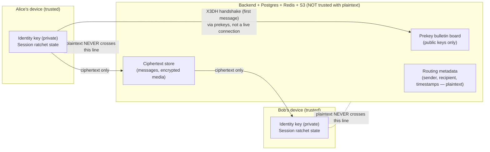

# End-to-End Encryption: Threat Model & Key Management Design

**Status: NOT IMPLEMENTED.** This is Phase 10's deliverable per the
roadmap ("Privacy/security hardening + E2EE architecture — exit criteria:
threat model doc + key management design reviewed"). Nothing in this
document is wired into the backend or the Android app. Per the project's
own security rule ("E2EE for message content is architected for but not
claimed as delivered until implemented and independently reviewed"), no
part of this app may claim end-to-end encryption until this design has
been implemented, tested, and reviewed by someone other than its author.

This document exists to be picked apart by a reviewer before a single
line of ratchet code is written — that's the point of doing it now,
separately from implementation.

---

## 1. What "end-to-end encrypted" would mean here

Today, a message's journey is: Android → TLS → backend → Postgres
(plaintext column) → TLS → recipient Android. The backend can read every
message, because it has to: it's the one deciding delivery, running
search (Postgres FTS, Phase 4), generating notification previews, and
enforcing group membership.

E2EE moves the trust boundary: the backend would continue to **route**
ciphertext (store it, fan it out over WebSocket/push, keep delivery
receipts) but could no longer **read** it. Only the sending and receiving
devices would hold the keys needed to decrypt. This is a Signal/WhatsApp-
style design, not a novel one — section 2 explains why that specific
design and not a custom scheme (spec rule: "no custom crypto").

### What stays unencrypted even after this ships
Being upfront about this before anyone assumes "E2EE" means "everything
is hidden from the server":
- **Metadata**: who messaged whom, when, how often, group membership,
  message sizes/types (text vs. image vs. voice), delivery/read receipt
  timestamps. None of this is protected by message-content E2EE — it's a
  different, much harder problem (traffic analysis resistance), explicitly
  out of scope here.
- **Media thumbnails/previews for push notifications**, unless the whole
  preview-generation pipeline (Phase 3) is redesigned to run client-side
  before upload — see section 6's migration plan for why this ships in a
  later sub-phase, not day one.
- **Search** (Phase 4's Postgres full-text search) — server-side search
  over ciphertext isn't something this design attempts; encrypted
  conversations would need to either lose server-side search or use
  client-side search over locally-decrypted history only (the latter is
  the assumption this design makes).
- **Anything already decrypted and sitting on a device** — screenshots,
  a compromised/rooted phone, a stolen unlocked device, and OS-level
  backups of app data are all outside what message encryption can
  protect against.
- **Group chats at scale**, practically speaking: the design below
  extends to groups (sender-keys, section 4.5), but group E2EE has
  materially weaker guarantees than 1:1 (removing a member doesn't
  rotate already-distributed keys without an explicit re-key step) —
  called out again in section 7.

---

## 2. Why Signal's design (X3DH + Double Ratchet), not something custom

The spec is explicit: *"no custom crypto, libsodium/standard TLS
libraries only."* Three reasons to follow the Signal Protocol's published
design specifically, rather than inventing a simpler variant:

1. **It's the only widely-deployed design that has survived public
   cryptographic review at this scale** (WhatsApp, Signal, Google
   Messages, Facebook Messenger secret conversations all use it or a
   direct derivative). A chat app built in 10 phases by one team without
   a dedicated crypto review is not the place to also invent a new
   ratchet construction.
2. **Forward secrecy and post-compromise security are both required
   properties**, not nice-to-haves, given the spec's own threat model
   (section 7: "architected for ... Signal-style double-ratchet
   primitives"). A simpler static-key scheme (e.g. just encrypting with a
   long-lived shared key) fails both: compromise one message key and an
   attacker who recorded traffic can decrypt everything retroactively
   (no forward secrecy) and everything going forward (no healing after
   compromise).
3. **Asynchronous delivery is a hard requirement** (spec: offline users
   get push + sync, not a live handshake) — X3DH is specifically designed
   to let Alice establish an encrypted session with Bob *without Bob
   being online*, using prekeys Bob uploaded in advance. A simpler
   Diffie-Hellman handshake would require both parties online
   simultaneously, which doesn't fit this app's delivery model at all.

---

## 3. Threat model

### 3.1 Assets being protected
- Message plaintext (text, and the plaintext bytes of media before/after
  transit — media encryption is addressed in section 6.4).
- Per-conversation session keys and the ratchet state derived from them.
- Each device's long-term identity private key.

### 3.2 Adversaries considered in scope
| Adversary | Capability assumed | What this design defends against |
|---|---|---|
| **Network attacker** (ISP, Wi-Fi, state-level passive/active MITM) | Can observe and tamper with all traffic between client and server; does not have server or device keys. | Already mitigated today by TLS 1.3; E2EE adds defense-in-depth if TLS were ever broken or a MITM proxy were trusted onto the network. |
| **Malicious or compromised backend operator** | Full read/write access to Postgres, Redis, S3, and application logs; can run arbitrary queries; could be an insider, a compromised credential, or a legal/government order compelling data production. | **This is the primary adversary E2EE is for.** With this design, the operator can see ciphertext, routing metadata, and group membership, but not plaintext message content. |
| **Attacker with a point-in-time database dump** (backup theft, a misconfigured snapshot exposed publicly, a subpoena for historical data) | Has a full copy of Postgres at one point in time, but not any device's private keys. | Forward secrecy (double ratchet) means even a full DB dump reveals nothing about message content, past or future, without a device's keys. |
| **Attacker who later compromises a device's long-term identity key** (e.g. recovers it from a poorly-wiped phone months later) | Obtains the long-term identity private key, but was not actively recording/MITM-ing traffic at the time of past conversations. | Forward secrecy still protects *past* messages (the per-message keys were already deleted/ratcheted away); post-compromise security (the ratchet's periodic DH re-keying) bounds how much of the *future* conversation is exposed once the legitimate device re-keys. |

### 3.3 Explicitly out of scope
- **A fully compromised endpoint** (malware on the phone with the app
  unlocked, a jailbroken/rooted device with the attacker in control, a
  coerced/unlocked device in the user's hand). If the attacker can read
  what the screen shows, no message-content encryption scheme defends
  against that — this is a client/OS security problem, not a protocol
  problem.
- **Traffic analysis / metadata protection** — see section 1.
- **Multi-device sync as a solved problem** — see section 4.6; this
  design does not attempt a Signal-"linked devices"-equivalent in Phase
  10, only single-primary-device E2EE, with multi-device explicitly
  flagged as unresolved.
- **Quantum-resistant key exchange** — X25519 (classical ECDH) is used,
  matching Signal's current production design; a post-quantum upgrade
  path (e.g. PQXDH) is noted as a future revision, not designed here.

### 3.4 Trust boundary diagram

The backend's role shrinks to: publish prekeys on behalf of offline
users, store and forward ciphertext blobs it cannot read, and continue
to see (and must continue to see, to function) who is talking to whom
and when.

---

## 4. Key management design

### 4.1 Identity keys
- Each **device** (not each user — a user with 2 phones has 2 identity
  keys, consistent with Signal's device-centric model) generates an
  X25519 key pair on first setup, inside the Android Keystore
  (hardware-backed where available), **non-exportable**.
- The public identity key is uploaded to the backend at registration
  time and is the one thing about this design the backend is trusted to
  distribute honestly — see section 7's "trust-on-first-use" caveat.
- The private identity key never leaves the device, never transits the
  network, and is not included in any backup this app controls
  (Android's own OS-level backup behavior for Keystore-protected keys is
  itself a deployment configuration question, flagged in section 7, not
  resolved here).

### 4.2 Prekeys (enabling asynchronous session start)
Each device also generates and uploads to the backend:
- **One signed prekey**: an X25519 key pair, signed by the device's
  identity key, rotated periodically (e.g. weekly) so a compromised
  prekey has a bounded window of usefulness.
- **A batch of one-time prekeys** (e.g. 100 at a time): single-use X25519
  key pairs. The backend hands one out per new incoming session request
  and the device replenishes its stock when it next connects. Running out
  of one-time prekeys degrades gracefully to using only the signed prekey
  (weaker forward secrecy for that one handshake, not a failure).

The backend's job here is purely custodial: it stores and serves public
keys on request, the same way a key server does. It never sees or needs
any private key material to do this.

### 4.3 Session establishment: X3DH
When Alice sends Bob the first message of a new conversation (Bob may be
offline):
1. Alice fetches Bob's identity key, current signed prekey (+ its
   signature, which she verifies against Bob's identity key), and one
   unused one-time prekey from the backend.
2. Alice performs the X3DH key agreement (a combination of several
   Diffie-Hellman computations between Alice's identity/ephemeral keys
   and Bob's identity/prekeys) to derive a shared secret, without Bob
   needing to be online.
3. Alice sends her first message, which includes the public keys Bob
   needs to derive the same shared secret on his side, encrypted under a
   key derived from that shared secret.
4. When Bob comes online and receives it, he performs the matching X3DH
   computation and decrypts.

### 4.4 Ongoing messages: the Double Ratchet
Once a session is established, every subsequent message uses the Double
Ratchet algorithm:
- A **symmetric-key ratchet** derives a fresh message key for every
  single message from a chain key, then advances the chain key forward
  (one-way) — so recovering one message key never reveals any other
  message's key (**forward secrecy** at message granularity, not just
  per-session).
- A **Diffie-Hellman ratchet** runs alongside it: every time the
  conversation "turns" (the other party replies), both sides perform a
  fresh DH computation and fold it into the chain, so even if an
  attacker fully compromises one side's current state, future messages
  become unreadable again as soon as the legitimate device sends or
  receives one more round (**post-compromise security** / "healing").
- Out-of-order and dropped messages are handled by retaining a bounded
  number of skipped message keys per chain, matching Signal's own
  published handling — needed here specifically because this app's
  delivery model allows offline queuing and out-of-order redelivery
  (Phase 2).

### 4.5 Group messaging
Groups (Phase 4) don't scale well with pairwise double-ratchet sessions
(an N-person group would need N·(N-1) pairwise sessions). The intended
design is **sender keys** (the approach Signal's own group messaging
uses): each group member generates a symmetric sender-key chain and
distributes it to every other member once (each distribution itself
protected by that member's pairwise double-ratchet session with each
recipient — so pairwise sessions are still a prerequisite, just not on
the hot path of every group message). Ordinary group messages are then
encrypted once, cheaply, under the sender's own chain key, and fan out
to the group the same way an unencrypted group message does today.

**Known weakness, flagged rather than hidden**: removing a member from a
group does not, by itself, invalidate the sender keys they've already
received — a removed member who kept the app's data could still decrypt
messages sent with a sender key they already hold until the group
explicitly re-keys (every remaining member generates and redistributes a
new sender key). This re-key-on-membership-change step is part of the
design but adds real complexity (detecting removal, coordinating re-key,
handling members who are offline during the re-key) deferred to
implementation-time design, not resolved further in this document.

### 4.6 Multi-device — explicitly unresolved
WhatsApp/Signal's multi-device support (same account, several linked
devices, each with the "right" to decrypt new messages) is a
substantial additional design surface (linked-device key distribution,
device revocation, consistent history across devices) that this
document does **not** attempt to resolve. The design above assumes one
primary device per identity key. Multi-device is called out here so it
isn't silently assumed solved — a real implementation plan needs its own
review before Android ships a "link a device" feature on top of this.

### 4.7 Verification ("safety numbers")
Because the backend distributes public keys (section 4.2), a malicious
or compromised backend could in principle hand Alice an attacker's
public key instead of Bob's real one (a classic trust-on-first-use MITM
risk — see section 7). The mitigation, same as Signal/WhatsApp: derive a
human-comparable fingerprint ("safety number") from both parties'
identity public keys, and let users optionally compare it out-of-band
(in person, or over a channel other than this app) to detect a
substituted key. This is a UI feature to design at implementation time,
not something the backend can provide — flagged here as a required
companion to the key-serving design, not optional polish.

---

## 5. What's stored where, once implemented

| Data | Where | Encrypted how |
|---|---|---|
| Device's own identity private key | Android Keystore only | Hardware-backed, non-exportable |
| Identity public key, signed prekey, one-time prekeys | Postgres (new tables, see section 6.2) | Not secret — these are meant to be public; integrity (the prekey signature) matters, confidentiality doesn't |
| Per-conversation ratchet state (chain keys, skipped message keys) | Device-local storage only (Room) | Never uploaded anywhere; losing the device loses the ability to decrypt that history unless a backup/export design is added later (not designed here) |
| Message ciphertext | Postgres `messages.body` (schema unchanged — it already stores a `TEXT`/`BYTEA`; E2EE changes *what* goes in it, not the column) | AES-256-GCM (per Double Ratchet message key), authenticated so tampering is detected, not just confidentiality |

---

## 6. Migration plan (how this would roll out without breaking Phases 1–9)

Deliberately additive and gradual — the existing plaintext chat (Phases
2–9) keeps working throughout:

1. **Sub-phase A — key infrastructure only.** Ship identity/prekey
   generation and the backend's prekey-serving endpoints
   (`POST /keys/identity`, `POST /keys/prekeys`, `GET /keys/bundle/{userId}`
   — new `keys` module, isolated like `ai` is). No conversation is
   encrypted yet; this just gets every device holding keys.
2. **Sub-phase B — opt-in per 1:1 conversation.** Add an
   `encryption_state` enum (`none | handshake_pending | active`) to
   `conversations`. A new 1:1 conversation can start E2EE; existing
   plaintext conversations are untouched and stay `none` — no forced
   migration of history, which the design doesn't attempt to retroactively
   encrypt anyway (there's no way to apply forward secrecy to messages
   already stored in plaintext).
3. **Sub-phase C — groups**, once sender-keys + re-key-on-membership-
   change is itself implemented and reviewed as its own increment.
4. **Sub-phase D — server-side feature adjustments for encrypted
   conversations**: push notification previews fall back to "New
   message" (no content preview) for `encryption_state = active`
   conversations; Postgres FTS search excludes them (client-side search
   over locally-decrypted history becomes the only option for those
   conversations — a real UX tradeoff to surface to users, not hide).
5. **Independent review gate**: per the spec's own rule, none of this is
   called "end-to-end encrypted" in the product until an independent
   review (someone other than the implementer) has gone through the
   actual implementation against this design.

---

## 7. Open questions for the reviewer

Listed honestly rather than glossed over, because this is the point of
writing the design doc before the code:

1. **Trust-on-first-use (TOFU) key distribution**: section 4.7's safety
   numbers are an optional, manual mitigation. Should the backend offer
   anything stronger (e.g. a key-transparency log, like Google's Key
   Transparency or WhatsApp's Auditable Key Directory) so a key
   substitution could be detected automatically rather than only by a
   user who thinks to compare numbers? This is a real gap today in the
   design as written.
2. **Backup strategy**: if a user's device is lost, their message
   history (encrypted locally, per section 5) is gone unless some backup
   design is added — and any backup design has to very carefully avoid
   quietly reintroducing server-readable plaintext (e.g. a naive
   "backup to Drive" feature that isn't itself end-to-end encrypted would
   undo the whole point). Not designed here; flagged as a prerequisite
   before marketing this as a complete feature.
3. **Key rotation triggers**: signed prekey rotation is suggested as
   time-based (weekly) above — is that the right cadence, and should
   re-registering a device (reinstall, factory reset) force new identity
   keys (breaking old safety-number verifications) or attempt continuity?
4. **Android Keystore backup behavior**: whether Android's own key
   backup/restore settings (which vary by OEM and Android version) could
   leak or lose Keystore-protected keys needs its own device-security
   review before relying on "non-exportable" as an absolute guarantee.
5. **Performance**: per-message Double Ratchet DH computation on every
   "turn" of a fast back-and-forth conversation, and sender-key
   distribution overhead for large groups, haven't been load-tested —
   Phase 12 (load testing) should include an E2EE-enabled scenario once
   this ships, not just plaintext chat throughput.
